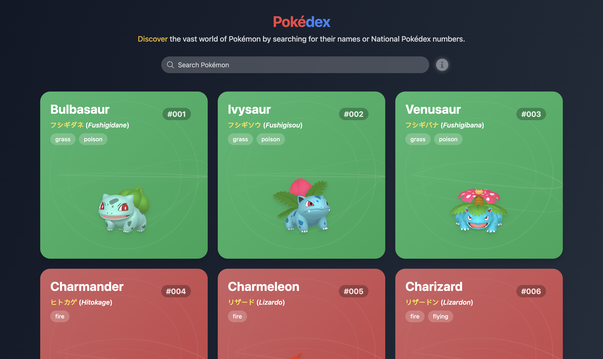

# Pokédex · Field Atlas

A responsive Pokémon field guide built with React, Vite, and Tailwind CSS. Browse type routes, search the National Pokédex, save field notes, and open detailed species entries. Live species data and artwork come from PokéAPI.

<p align="center">
  
</p>

## Features

- Explore the catalog by name, National Pokédex number, or Pokémon type
- Browse a progressively loaded catalog and filter the complete results by type
- Keep favorite species in a personal field-notes list stored in the browser
- Open an accessible species view with overview, base stats, evolution route, and moves
- Use the catalog on desktop or mobile, with keyboard-friendly search and reduced-motion support

## Technologies Used

- React
- Vite
- Tailwind CSS
- Framer Motion
- PokeAPI
- React-icons

## Getting Started

### Prerequisites

- Node.js (v14 or later)
- npm or yarn

### Installation

1. Clone the repository:
   ```
   git clone https://github.com/melvinSunday/Pokedex.git
   ```

2. Navigate to the project directory:
   ```
   cd pokedex-react-app
   ```

3. Install dependencies:
   ```
   npm install
   ```
   or
   ```
   yarn install
   ```

4. Start the development server:
   ```
   npm run dev
   ```

5. Open your browser and visit `http://localhost:5173` to see the app running.

### Performance check

Run `npm run build` followed by `npm run check:bundle` to check the production page against its 120 KB gzip budget.

## Project Structure

```
src/
├── components/
│   ├── Context/
│   │   └── Context.jsx
│   ├── FetchPokemons.jsx
│   ├── LoadingSkeleton.jsx
│   ├── MainPage.jsx
│   ├── PokemonDetailsDialog.jsx
│   ├── PokemonCard.jsx
│   ├── Pokemons.jsx
│   ├── SearchBar.jsx
│   └── typeVisuals.js
├── App.jsx
├── main.jsx
└── index.css
```

## Contributing

Contributions are welcome! Please feel free to submit a Pull Request.

## Acknowledgements

- [PokeAPI](https://pokeapi.co/) for providing the Pokémon data
- [Vite](https://vitejs.dev/) for the fast development environment
- [Tailwind CSS](https://tailwindcss.com/) for the utility-first CSS framework
- [Framer Motion](https://www.framer.com/motion/) for the animation library
- [React Icons](https://react-icons.github.io/react-icons/) for interface icons


## Credits

© 2024 Melvin Giovanni Domingo. All rights reserved.


